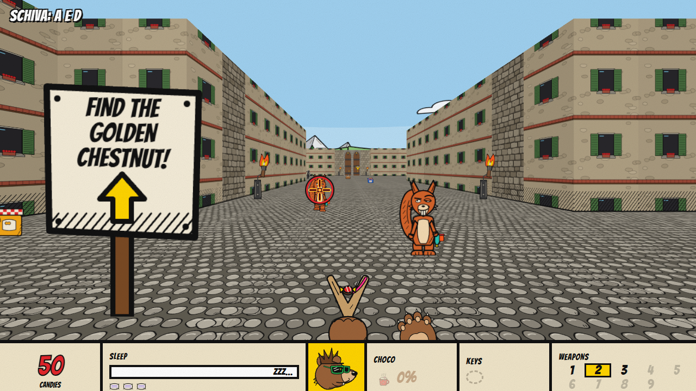
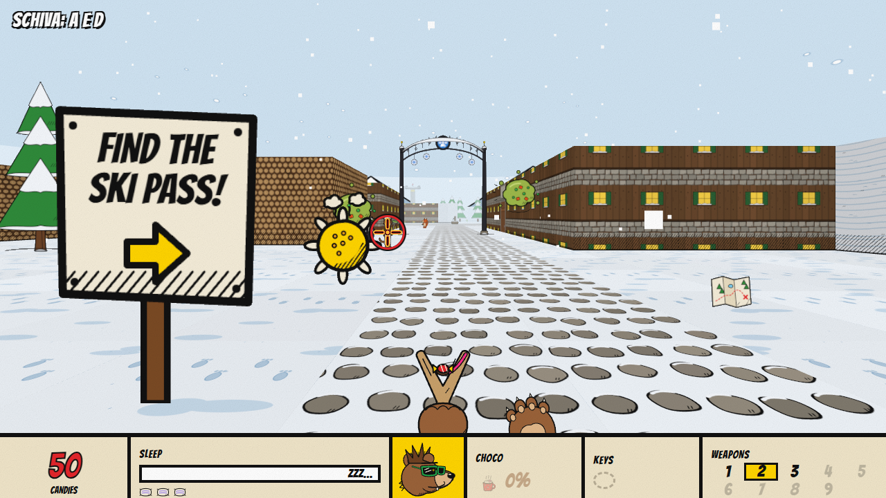

# ORSI!

Uno sparatutto in prima persona alla DOOM, ma con orsi che sparano dolciumi. Pensato per bambini di 6–10 anni da giocare insieme a un adulto: da soli, o in due sulla stessa tastiera (uno guida, l'altro spara). Nessuno si fa male: gli avversari restano storditi, con la pancia piena, con le guance gonfie o chiusi nella gelatina. Loro, invece, cercano di far **addormentare** l'orso.

Gira interamente nel browser: nessun backend, nessun account. Le scritte del gioco sono in inglese (come nei vecchi videogiochi), le istruzioni in italiano.

**Gioca online:** <https://martinocrippa.github.io/BearsOneActionShotGameWeb/>



## Come si gioca in locale

Serve **Node.js 22.12 o più recente** e un browser con WebGL (Edge, Chrome o Firefox recenti).

| Sistema | Come si avvia |
| --- | --- |
| Windows | Doppio clic su **`Avvia-Gioco.cmd`** |
| Qualunque | `npm install` e poi `npm run dev`, poi apri <http://127.0.0.1:5180> |

La finestra del server va lasciata aperta mentre si gioca. Internet serve solo per l'installazione.

### Comandi

Solo tastiera, come nel DOOM originale: la mira in alto e in basso è automatica, e se un avversario (o un cestino) è quasi davanti il colpo va su di lui.

| | Da soli | In due |
| --- | --- | --- |
| Avanti / indietro | `↑` `↓` | **chi guida**: `↑` `↓` |
| Girarsi (= mirare) | `←` `→` | **chi spara**: `A` `D` |
| Schivare (di lato) | `A` `D`, oppure `SHIFT` + `←` `→` | **chi guida**: `←` `→` |
| Sparare | `SPAZIO` | **chi spara**: `SPAZIO` |
| Saltare | `ALT GR` (o `INVIO`) | **chi guida**: `ALT GR` |
| Armi | `Q` `E` o `1`–`9`; `0` le armi bonus | **chi spara**: `Q` `E` |
| Mappa (finché è premuto) | `TAB` | |
| Pausa / musica | `ESC` / `M` | |

Nei menu bastano frecce, `INVIO` e `ESC`.

## Cosa c'è dentro



- **Episodio 1 completo**, ricalcato sul primo episodio di DOOM: nove livelli, dalla radura del bosco allo stadio con il boss, più il livello segreto sulla neve. *The Clearing*, *Increa Park*, *The Pitch in the Rain*, *School at Dawn*, *Break Time* (l'aula gigante), *The Castle*, *The River*, *The Stadium* e *Snowy Peaks*. Chiavi, porte, leve, ascensori, passaggi segreti e una pagella alla fine di ogni livello.
- **Tre orsi** con un loro talento (più veloce, salta più in alto, resiste di più al sonno), **nove avversari** e **nove armi**: zampata, fionda di caramelle, sparaconfetti, liquirizie, gelatina, zucchero filato, balestra, estintore FIZZ e la B.F.G. (Big Fat Gumball). Ogni arma ha il suo effetto comico.
- **La barra del Sonno** al posto della salute: il miele sveglia, la cioccolata calda fa da armatura, tre addormentate e compare YOU LOSE.
- **Cartelli** che dicono cosa cercare, con una freccia che indica la strada giusta da dove li guardi (e se prima serve un'altra chiave, chiedono quella). Sulla mappa (`TAB`) le chiavi ancora da prendere hanno il colore della loro porta. I **cestini** colpiti scoppiano in coriandoli, come i barili di DOOM. Si può **salire sulle auto e sui trattori** saltandoci sopra, e nei punti difficili compare un'istruzione in italiano.
- **Stanze bonus** a Increa, al campo dell'Arca e al castello: dietro una porta **BONUS** un Topo propone una sfida con 3 tentativi (pesca della carpa d'oro, rigori contro il Topo portiere, giostra con la fionda). Chi vince prende un'**arma assurda** sul tasto `0`: Sputa-carpa, Sparapalloni, Lancia-torte.
- **LEARN**: un livello di allenamento con le istruzioni e le sagome di cartone.
- **Gara dei trattori**, un segreto a *Increa Park*: chi sale sul tetto del trattore rosso si sente chiedere *TRACTOR RACE?*. Due giri su una pista di terra attorno a un campo di fieno, dal posto di guida, contro il Cinghialotto, il Gallo e la Volpe; in due lo schermo si divide, un trattore a testa. Chi vince torna nel livello con un premio.
- **BONUS: SWEET SHOT**, che si sblocca alla fine dell'episodio: tiro a segno con il fucile a bastoncino di zucchero su anatre, uccellini e gufi, in tre livelli (*Dawn at the Pond*, *Noon in the Woods*, *Night of the Owls*).
- **Quattro difficoltà**, da *Sleepy Cub* a *Ultra-Sugar*: sulle due facili l'orso cammina e gira più piano. Salvataggio automatico ai checkpoint e una password in stile anni '90 per continuare su un altro computer.
- **Musica punk melodica** scritta come dati (`src/music.js`) e suonata dal vivo da un sintetizzatore: un brano per livello.

### Codici segreti (si scrivono mentre si gioca)

| Codice | Effetto |
| --- | --- |
| `IDDQD` | Non ti addormenti mai |
| `IDKFA` | Tutte le armi, tutti i dolci, le chiavi del livello |
| `IDFA` | Tutte le armi e tutti i dolci |
| `ORSOFORTE` | Come IDDQD |
| `ZUCCHERONE` | Dolci infiniti |
| `IDDT` | Tutta la mappa |
| `IDCLEV` + numero | Salta al livello (1–9) |
| `IDBONUS` | Sblocca il bonus SWEET SHOT |

### Password dei livelli

Si scrivono in **PASSWORD** nel menu: si parte da quel livello a difficoltà *It Tickles*, con 3 cuscini e le armi dei livelli prima.

| Livello | Orsa | Piccolo | Grande |
| --- | --- | --- | --- |
| E1M1 The Clearing | `BF4Q-GSVG-BBHLN` | `BQRZ-69SK-HSDG4` | `B3G9-WQQN-N99CJ` |
| E1M2 Increa Park | `CNTT-HK5N-T4R84` | `CZJ4-723R-3LN44` | `C98D-XHZV-84KZJ` |
| E1M3 The Pitch in the Rain | `DWLX-96S6-8G75J` | `D798-2MRB-FX4ZQ` | `FJZJ-Q4PF-MGZXG` |
| E1M4 School at Dawn | `F6C4-FTJ4-4C674` | `GG3C-6BG7-9T36D` | `GRQM-VRFC-HCX22` |
| E1M5 Break Time | `HD47-CN9K-VCQTQ` | `HPSG-357N-3TMPX` | `H2HQ-SL5R-9CJLD` |
| E1M6 The Castle | `JMVB-N6XP-HF44D` | `JXKL-FMVS-NWZ24` | `J88T-54SW-VFVV4` |
| E1M7 The River | `KVMF-L2N5-9FNPS` | `K7BP-CHL9-GWKK8` | `LHZX-3XKD-NFGJJ` |
| E1M8 The Stadium | `L5DK-7F78-FFV9J` | `MF3T-WV6C-LWR5X` | `MQQ5-NC4G-SFNZX` |
| E1M9 Snowy Peaks (segreto) | `NC5L-237D-Z9X7J` | `NNSV-RJ5H-7RT3X` | `NZH6-HZ3M-D9QZ8` |

## Privacy

Non esce niente dal computer, nemmeno dalla versione online: nessuna statistica, nessun tracciamento, nessun account. Salvataggio e bonus sbloccato stanno nel `localStorage` del browser con il prefisso `orsi:` e si azzerano svuotando i dati del sito. L'unico collegamento esterno è il regalo alla fine dell'episodio: apre un video sul canale ufficiale della Serie A, in una nuova scheda, solo se lo si clicca.

## Se ci metti mano

```bash
git clone https://github.com/martinocrippa/BearsOneActionShotGameWeb.git
cd BearsOneActionShotGameWeb
npm install
npm run dev
```

| Comando | Cosa fa |
| --- | --- |
| `npm run dev` | Server di sviluppo su <http://127.0.0.1:5180> |
| `npm test` | Test della logica in Node: ogni livello è valido e si finisce nell'ordine giusto, Sonno, codici, password, collisioni, comandi, cartelli |
| `npm run smoke` | Con `npm run dev` acceso: gioca un livello in Microsoft Edge e salva gli screenshot in `smoke-shots/` |
| `npm run build` / `npm run preview` | Sito statico in `dist/` e anteprima |
| `node scripts/check-level.mjs levels/defs/e1mN.js` | Controlla un livello: mappa chiusa, chiavi, porte, uscita raggiungibile |

Il contenuto è fatto di dati, non di codice:

- un livello è una **mappa di testo** (`levels/e1mN-*.txt`) più una definizione (`levels/defs/e1mN.js`), con la legenda spiegata in [levels/LEGENDA.md](levels/LEGENDA.md);
- orsi, armi, avversari, oggetti, codici, difficoltà e bonus stanno in `data/`;
- ogni disegno ha un nome (`enemies/scoiattolo/walk_f_1`…): i file stanno in `public/assets/` ([public/assets/README.md](public/assets/README.md)), e se uno manca il gioco ne disegna uno di riserva.

Ogni push su `main` fa partire `.github/workflows/deploy.yml`: test, build e pubblicazione su GitHub Pages, solo se i test passano.

---

## Licenza

Codice sotto licenza MIT ([LICENSE](LICENSE)). I disegni in `public/assets/` e gli screenshot in `docs/` restano di tutti i diritti riservati. Componenti di terze parti in [THIRD_PARTY.md](THIRD_PARTY.md).

Un omaggio alle idee e alla struttura di DOOM (episodi, chiavi, segreti, codici): nessuna grafica, suono o mappa originale. Disegni fatti con Claude Design, codice scritto con Claude Code.
